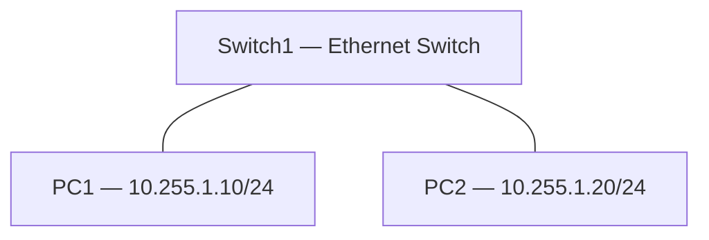

# Lab 01 — Virtualization and Network Lab Foundation

**Phase:** 01 — Lab Foundation  
**Status:** Verified  
**Implementation:** 25–26 November 2026

## 1. Overview

Before building the Dublin and Limerick networks, I needed to prepare the environment that would host the LionraForge infrastructure.

In this lab, I prepared my primary physical host, installed VMware Workstation Pro and GNS3, deployed an Ubuntu Server virtual machine, and configured the GNS3 VM.

I also tested communication between the physical host and a virtual machine, resolved two networking and software compatibility issues, and built a simple network topology to confirm that GNS3 was working correctly.

This lab provides the foundation for the enterprise networking, Windows Server, Active Directory and IT Support labs that follow.

## 2. Objectives

- Prepare the physical host for virtualization.
- Organise storage for virtual machines and network projects.
- Install and configure VMware Workstation Pro.
- Deploy a Linux virtual machine and test its functionality.
- Understand VMware's default virtual networking modes.
- Install GNS3 and integrate it with VMware.
- Confirm nested virtualization availability.
- Build and test a basic virtual network.
- Investigate and resolve technical problems encountered during implementation.

## 3. Physical Infrastructure

I'm using two laptops for LionraForge. However, I decided to use the Gigabyte Aero 15 as my primary virtualization host and keep the AMD Ryzen laptop available for additional workloads when required.

This allows me to work on the core infrastructure without keeping both physical machines running continuously.

### Primary Host

| Component | Specification |
|---|---|
| Manufacturer and model | Gigabyte Aero 15-SA |
| Processor | Intel Core i7-9750H |
| Installed RAM | 16 GB |
| Reported RAM | 15.8 GB |
| Operating system | Windows 11 Home, 64-bit |
| System storage | 256 GB Intel SSD |
| Secondary storage | 1 TB Crucial SSD |
| Hardware virtualization | Enabled |

### Expansion Host

| Component | Specification |
|---|---|
| Processor | AMD Ryzen 7 5700U |
| RAM | 16 GB |
| Role | Additional virtualization workloads |
| Deployment status | Planned |

The two modeled office locations are logical network sites. They are not permanently assigned to individual physical laptops.

## 4. Software Environment

| Software | Installed version | Purpose |
|---|---|---|
| VMware Workstation Pro | 26H1u1 — 26.0.1.25688693 | Virtual machine hosting |
| Ubuntu Server | 26.04.1 LTS | Initial virtual machine testing |
| GNS3 | 2.2.61 | Network simulation and management |
| GNS3 VM | 0.21.0 | Virtual network appliance hosting |
| GNS3 Server | 2.2.61 | Network simulation backend |
| QEMU | 10.2.1 | Virtual appliance execution |
| PuTTY | Version not recorded | Console access |

## 5. Preparing the Physical Host

### 5.1 Hardware and Operating System

Before installing virtualization software, I inspected the host operating system, available memory, storage capacity, disk health and virtualization support.

The machine has sufficient resources for the initial lab, although its 16 GB RAM means that I need to deploy infrastructure gradually and manage which virtual machines are running.

### Storage Inventory

| Drive | Capacity | Free space at inspection | Purpose |
|---|---:|---:|---|
| C: | 238.5 GB | 166.9 GB | Windows and applications |
| D: | 931.5 GB | 492.5 GB | Virtual machines and lab resources |

Both disks reported a healthy status and use the NTFS filesystem.

### 5.2 Windows Hypervisor Inspection

I confirmed that hardware virtualization was enabled and inspected whether the Windows hypervisor was running.

In PowerShell:

```powershell
Get-CimInstance Win32_ComputerSystem |
    Select-Object HypervisorPresent
```

I also inspected the relevant optional Windows features using elevated PowerShell:

```powershell
Get-WindowsOptionalFeature -Online |
    Where-Object FeatureName -in @(
        "Microsoft-Hyper-V-All",
        "VirtualMachinePlatform",
        "HypervisorPlatform"
    ) |
    Select-Object FeatureName, State
```

The results were:

| Component | Result |
|---|---|
| Hardware virtualization | Enabled |
| HypervisorPresent | False |
| VirtualMachinePlatform | Disabled |
| HypervisorPlatform | Disabled |
| Microsoft-Hyper-V-All | Not returned |

I did not need to modify any Windows virtualization or security settings during this inspection.

### 5.3 Storage Organisation

I chose to separate installed applications from virtual machine data.

VMware Workstation and GNS3 are installed on C:, while virtual disks, network projects and installation resources are intended to be stored on D:.

I created the following directory structure:

```text
D:\LionraForge\
├── Backups\
├── GNS3-Projects\
├── ISO-Images\
└── Virtual-Machines\
```

The directories can be created with PowerShell:

```powershell
$LabRoot = "D:\LionraForge"

$Folders = @(
    "Virtual-Machines",
    "GNS3-Projects",
    "ISO-Images",
    "Backups"
)

New-Item -Path $LabRoot -ItemType Directory -Force

foreach ($Folder in $Folders) {
    New-Item -Path (Join-Path $LabRoot $Folder) `
        -ItemType Directory -Force
}
```

Verification:

```powershell
Get-ChildItem -Path "D:\LionraForge" -Directory
```

Keeping virtual machine data on the secondary SSD reduces pressure on the Windows system drive and makes the lab easier to organise.

The Backups directory is intended for local backup files and exports. It does not provide protection against failure of the secondary SSD itself.

## 6. VMware Workstation Deployment

### 6.1 Installation

I downloaded VMware Workstation Pro from Broadcom's official download portal and installed version 26H1u1.

I retained the standard installation directory:

```text
C:\Program Files\VMware\VMware Workstation
```

After installation, I opened VMware Workstation and confirmed its installed version through the About window.

### 6.2 Virtual Machine Storage

I changed the default virtual machine location through:

Edit → Preferences → Workspace

Default virtual machine location:

```text
D:\LionraForge\Virtual-Machines
```

### 6.3 Supporting Services

I inspected the VMware services registered on the Windows host:

```powershell
Get-Service |
    Where-Object {
        $_.DisplayName -like "*VMware*"
    } |
    Select-Object Name, DisplayName, Status, StartType
```

The authorization, DHCP, NAT and USB arbitration services were running.

The VMware Autostart Service was stopped with a manual startup type. I retained this configuration because I intend to control virtual machine startup manually.

### 6.4 VMware Virtual Networking

I inspected the default networks through:

Edit → Virtual Network Editor

| Network | Mode | Subnet | VMware DHCP |
|---|---|---|---|
| VMnet0 | Bridged | Physical network | Not applicable |
| VMnet1 | Host-only | 192.168.108.0/24 | Enabled |
| VMnet8 | NAT | 192.168.24.0/24 | Enabled |

VMnet0 uses auto-bridging to connect virtual machines to the physical network.

VMnet1 provides private communication between the host and connected virtual machines.

VMnet8 allows virtual machines to access external networks through the host using network address translation.

I retained the default configuration for this initial lab.

The VMware host adapter addresses were:

| Adapter | IPv4 address |
|---|---|
| VMnet1 | 192.168.108.1/24 |
| VMnet8 | 192.168.24.1/24 |

To inspect these addresses in PowerShell:

```powershell
Get-NetIPAddress -AddressFamily IPv4 |
    Where-Object {
        $_.InterfaceAlias -like "*VMnet*"
    } |
    Select-Object InterfaceAlias, IPAddress,
        PrefixLength, AddressState
```

These networks are used for virtualization management and initial testing. The actual Dublin and Limerick enterprise networks will be configured separately.

## 7. Deploying the First Virtual Machine

I deployed an Ubuntu Server virtual machine to confirm that VMware could run a guest operating system and provide working virtual networking.

### Virtual Machine Configuration

| Parameter | Configuration |
|---|---|
| Virtual machine name | TEST-VM01 |
| Hostname | test-vm01 |
| Operating system | Ubuntu Server 26.04.1 LTS |
| Architecture | x86-64 |
| vCPUs | 2 |
| RAM | 2 GB |
| Virtual disk | 25 GB |
| Network | VMnet1 — Host-only |
| Storage management | LVM |
| Filesystem | ext4 |

### 7.1 Installation Procedure

1. Download the Ubuntu Server installation ISO.
2. Verify the ISO integrity against the official SHA-256 checksum.
3. Create a new virtual machine in VMware Workstation.
4. Allocate two virtual CPU cores, 2 GB RAM and a 25 GB virtual disk.
5. Connect the virtual network adapter to the host-only network.
6. Attach the Ubuntu ISO and start the virtual machine.
7. Select the standard Ubuntu Server installation.
8. Keep automatic DHCP configuration.
9. Use guided storage partitioning with LVM.
10. Configure the hostname and create a local administrative user.
11. Complete the installation and reboot.

I used a standard server installation without a graphical desktop environment.

The test machine does not use guest-level disk encryption. This is a decision for this temporary test environment, not a general security policy for future LionraForge servers.

### 7.2 System Verification

After installation, I logged in successfully and inspected the operating system and allocated resources.

```bash
hostnamectl
whoami
id
systemd-detect-virt
sudo whoami
lscpu
nproc
free -h
lsblk
df -hT
```

The tests confirmed:

- Ubuntu Server 26.04.1 LTS was running.
- VMware was detected as the virtualization platform.
- Two virtual CPUs were available.
- The local user could perform administrative operations through sudo.
- The 25 GB virtual disk and LVM filesystems were recognised correctly.

The guest reported 1.6 GiB of usable RAM with 2 GB configured in VMware. It had approximately 1.1 GiB available at the time of inspection, with no swap usage.

### 7.3 Network Connectivity

The virtual machine received an IPv4 address automatically from VMware's DHCP service.

At the time of the final connectivity test:

| System | IPv4 address |
|---|---|
| Windows host — VMnet1 | 192.168.108.1/24 |
| Ubuntu TEST-VM01 | 192.168.108.130/24 |

I tested communication from Windows to Ubuntu:

```powershell
ping 192.168.108.130
```

And from Ubuntu to Windows:

```bash
ping -c 4 192.168.108.1
```

Initially, communication from Ubuntu to Windows failed. I investigated the problem and resolved it using a restricted Windows Firewall rule.

The final guest-to-host test returned:

```text
4 packets transmitted, 4 received, 0% packet loss
```

The investigation and resolution are recorded in the [troubleshooting journal](troubleshooting.md).

## 8. GNS3 Deployment

### 8.1 Installing GNS3

I installed GNS3 version 2.2.61 on the Windows host and downloaded the matching GNS3 VM package for VMware Workstation.

I retained the standard GNS3 application installation location on C:.

### 8.2 Importing the GNS3 VM

The downloaded GNS3 VM package contains a preconfigured virtual appliance.

I extracted the downloaded archive and opened the OVA file through VMware Workstation.

The intended storage location was:

```text
D:\LionraForge\Virtual-Machines\GNS3 VM
```

I imported the appliance rather than installing its operating system manually.

### 8.3 GNS3 VM Resources

I selected the following starting resource allocation:

| Resource | Configuration |
|---|---|
| Virtual CPUs | 4 |
| RAM | 4096 MB |
| Nested virtualization | Intel VT-x/EPT enabled |
| Network adapters | Appliance defaults |

These are the selected settings; I did not independently measure the final CPU and RAM allocation inside the appliance.

These resources can be adjusted later depending on the number and type of network devices running inside GNS3.

Nested virtualization is particularly important for network appliances that require QEMU with KVM acceleration.

### 8.4 VMware Integration

I configured GNS3 to run network appliances inside the GNS3 VM rather than relying only on the Windows local server.

The local GNS3 server settings were:

| Setting | Value |
|---|---|
| Server executable | C:\Program Files\GNS3\gns3server.EXE |
| Host binding | localhost |
| TCP port | 3080 |

During integration, GNS3 could not locate VMware's vmrun executable.

I investigated the VMware installation path, tested the executable directly and resolved the discovery problem by making the VMware installation directory available through the Windows PATH environment variable.

The detailed investigation is available in the [troubleshooting journal](troubleshooting.md).

### 8.5 GNS3 VM Verification

After resolving the compatibility problem, GNS3 started the imported virtual machine successfully.

The GNS3 VM console reported:

| Parameter | Result |
|---|---|
| GNS3 Server | 2.2.61 |
| VM version | 0.21.0 |
| Ubuntu release codename | Resolute |
| QEMU | 10.2.1 |
| Virtualization | VMware |
| KVM support available | True |
| Management IP at startup | 192.168.108.131 |
| Web interface port | 80 |

Both the Windows local server and GNS3 VM appeared online in the GNS3 Servers Summary panel.

I also restarted the environment and confirmed that GNS3 could launch the virtual machine normally without requiring a PowerShell-based application launch.

### 8.6 Project Storage

I configured the local GNS3 project directory through:

Edit → Preferences → General → Local paths

```text
D:\LionraForge\GNS3-Projects
```

Runtime data and appliances hosted within the GNS3 VM may also be stored internally under `/opt/gns3`.

## 9. Building the First Network

Before introducing the actual enterprise networks, I built a simple isolated topology using an Ethernet switch and two lightweight VPCS endpoints.

### Project

```text
LF-P01-L01-Network-Test
```

### Topology



### IP Addressing

| Device | IPv4 address | Subnet mask |
|---|---|---|
| PC1 | 10.255.1.10 | 255.255.255.0 |
| PC2 | 10.255.1.20 | 255.255.255.0 |

I selected a separate test subnet that does not overlap with the planned Dublin or Limerick enterprise networks.

### Configuration Procedure

1. Create a blank GNS3 project.
2. Add one Ethernet switch and two VPCS devices.
3. Select the GNS3 VM as the execution server for the devices.
4. Connect both endpoints to the switch.
5. Start the devices and open their consoles.

PC1 configuration:

```text
ip 10.255.1.10/24
save
```

PC2 configuration:

```text
ip 10.255.1.20/24
save
```

### Connectivity Test

From PC1:

```text
ping 10.255.1.20
```

The destination returned five successful ICMP replies.

| Test | Result |
|---|---|
| Network device startup | Passed |
| Console access | Passed |
| Ethernet connectivity | Passed |
| IPv4 communication | Passed |
| ICMP replies | 5 out of 5 |
| Packet loss | 0% |

This confirms that the initial GNS3 switching environment is functioning correctly.

## 10. Troubleshooting

During this lab, I encountered and resolved two technical problems:

| Problem | Resolution |
|---|---|
| Ubuntu virtual machine unable to ping the Windows host | Configured a restricted inbound ICMP firewall rule for VMnet1. |
| GNS3 unable to locate VMware's vmrun executable | Added the VMware installation directory to the Windows PATH environment variable. |

Both solutions were verified through successful functionality tests.

[Read the troubleshooting journal](troubleshooting.md)

## 11. Verification

The required foundation acceptance tests passed.

[View the verification results](verification.md)

The scope of this lab is the working virtualization and basic network simulation environment.

Advanced features such as snapshot restoration, NAT connectivity, KVM-based router appliance execution and enterprise VLAN routing will be tested in later labs when required.

## 12. What I Learned

This lab helped me understand how the physical host, virtualization platform, guest operating systems and network simulation software work together.

In particular, I gained practical experience with:

- Windows and Linux system inspection.
- PowerShell administration.
- Virtual machine deployment and resource allocation.
- Linux storage and LVM.
- DHCP and virtual network configuration.
- Windows Firewall troubleshooting.
- Windows environment variables.
- Software compatibility investigation.
- GNS3 network deployment and connectivity testing.

I also learned the importance of focusing verification on the functionality required for each implementation rather than spending unnecessary time inspecting every available configuration parameter.

## 13. Next Lab

The next stage is to build the LionraForge enterprise network, starting with the Dublin headquarters network before introducing the Limerick branch and inter-site routing.

## 14. References

- [Broadcom Support Portal](https://support.broadcom.com/)
- [Ubuntu Server](https://ubuntu.com/download/server)
- [GNS3 Documentation](https://docs.gns3.com/)
- [GNS3 2.2.61 Release](https://github.com/GNS3/gns3-gui/releases/tag/v2.2.61)
- [Microsoft PowerShell Documentation](https://learn.microsoft.com/en-us/powershell/)
